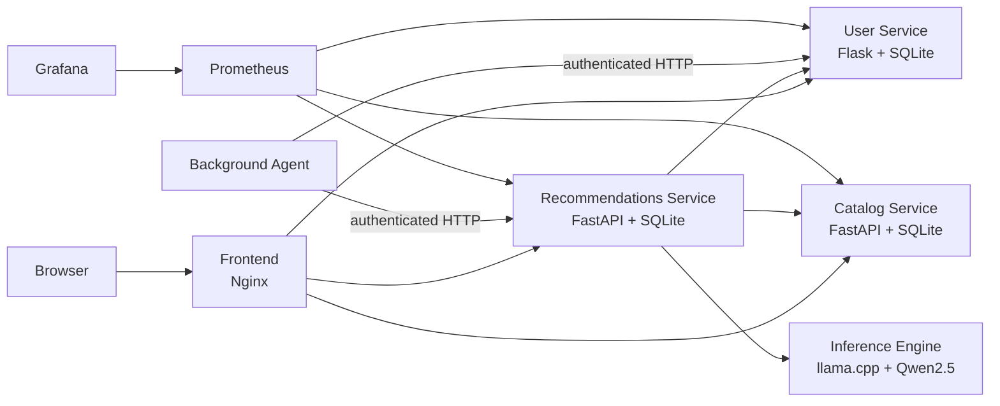

# Movie Recommendation Cloud

Plataforma de recomendação de filmes baseada em IA, desenvolvida no âmbito da unidade curricular **Platforms for AI Systems** do Mestrado em Engenharia Informática do Instituto Superior Técnico.

O projeto implementa uma aplicação web baseada em microserviços, executável localmente com Docker Compose e preparada para deployment num cluster Kubernetes auto-gerido em Google Cloud Platform. Os utilizadores podem criar uma conta, configurar as suas preferências e pedir recomendações personalizadas. Um agente em background gera e atualiza recomendações automaticamente com base no perfil de cada utilizador.

> O projeto foi originalmente desenvolvido e entregue num repositório GitLab. A existência de [`.gitlab-ci.yml`](.gitlab-ci.yml) reflete essa integração; o código pode ser consultado e reproduzido a partir do GitHub sem depender do GitLab para executar a aplicação localmente.

## Funcionalidades

- Registo, autenticação e gestão de perfis de utilizador.
- Preferências e exclusões por género, com suporte a filtros por ano.
- Catálogo de filmes baseado no dataset MovieLens.
- Recomendações personalizadas através de um modelo local Qwen2.5 servido por llama.cpp.
- Pedidos em linguagem natural, incluindo português, por exemplo: `Quero uma comédia dos anos 90`.
- Explicações construídas a partir dos dados reais do catálogo.
- Persistência de utilizadores, catálogo e recomendações em bases de dados SQLite.
- Cache da recomendação mais recente, com deteção de resultados desatualizados quando o perfil muda.
- Agente periódico que preenche ou atualiza recomendações sem interação manual.
- Dashboard de métricas com Prometheus e Grafana.
- Deployment reproduzível em Kubernetes com Terraform, Ansible e kubeadm.
- Pipeline CI/DevSecOps com testes, SAST, auditoria de dependências, deteção de segredos e análise de imagens Docker.

## Arquitetura



| Componente | Responsabilidade | Implementação |
| --- | --- | --- |
| Frontend | Interface web e gateway HTTP | HTML, CSS, JavaScript e Nginx |
| User | Contas, sessões e perfis | Flask e SQLite |
| Catalog | Pesquisa e seleção de filmes | FastAPI, SQLite e MovieLens |
| Recommendations | Orquestração, cache e API | FastAPI e SQLite |
| Inference | Interpretação dos pedidos | llama.cpp com Qwen2.5-1.5B-Instruct-GGUF |
| Agent | Atualização periódica | Worker Python |
| Monitoring | Métricas e dashboard | Prometheus e Grafana |

Cada microserviço de domínio é dono dos seus próprios dados. Recommendations comunica com User e Catalog através das APIs, não acedendo diretamente às bases de dados dos outros serviços.

## Executar localmente

### Pré-requisitos

- Docker Desktop ou Docker Engine.
- Docker Compose v2 (`docker compose version`).
- Alguns GB de RAM e espaço em disco para as imagens e o modelo.

### Arranque

Na raiz do repositório:

```bash
python3 scripts/setup_agent.py
docker compose up -d --build
```

O primeiro arranque descarrega aproximadamente 1,1 GB de pesos para o volume `model-cache`. Aguarde até o serviço de inferência estar pronto:

```bash
docker compose exec -T inference curl -fsS http://localhost:8080/health
```

Abra <http://localhost:8080>, crie uma conta, configure os géneros em **My profile** e abra **Recommendations**. A geração em CPU pode demorar dezenas de segundos. O agente executa um ciclo inicial e, por omissão, repete-o a cada 300 segundos.

### Serviços locais

| Serviço | Endereço |
| --- | --- |
| Aplicação | <http://localhost:8080> |
| Prometheus | <http://localhost:9090> |
| Grafana | <http://localhost:3000> |

O Grafana é provisionado automaticamente. O dashboard está disponível sem login e a password administrativa de demonstração é `admin`. A documentação está em [`monitoring/README.md`](monitoring/README.md).

### Parar e limpar

```bash
docker compose down
```

Este comando mantém os volumes nomeados. Para remover também contas, catálogo, recomendações e pesos do modelo:

```bash
docker compose down -v
```

## Testes

```bash
node --test frontend/tests/*.test.js
docker compose exec -T catalog python -m unittest discover -s tests -v
docker compose exec -T recommendations python -m unittest discover -s tests -v
```

Existe também uma suite de integração isolada, com User, Catalog, Recommendations e Nginx reais e inferência determinística simulada. Os comandos estão em [`services/recommendations/README.md`](services/recommendations/README.md).

## Deployment em Kubernetes

O deployment cloud usa Kubernetes auto-gerido, não um serviço gerido como GKE. A infraestrutura é criada com Terraform em GCP, as máquinas são configuradas com Ansible e o cluster é inicializado com kubeadm. Os manifests estão em [`k8s/`](k8s/) e as instruções completas em [`infra/README.md`](infra/README.md) e [`k8s/README.md`](k8s/README.md).

Fluxo resumido: criar/configurar o projeto GCP; criar VMs e rede com Terraform; instalar Kubernetes com Ansible; publicar as quatro imagens da aplicação para um registry; e aplicar os manifests. O frontend é exposto por NodePort `30080`; Prometheus e Grafana usam `30090` e `30030`.

> A infraestrutura GCP gera custos. Depois dos testes, execute `terraform destroy` quando for seguro fazê-lo. Os endereços públicos usados numa validação anterior já não estão ativos.

## CI e DevSecOps

O pipeline em [`.gitlab-ci.yml`](.gitlab-ci.yml) foi criado para GitLab e corre em cada commit, branch, tag ou merge request. No GitHub, o ficheiro documenta a pipeline original, mas requer uma instância GitLab e um GitLab Runner para ser executado.

| Stage | Verificações |
| --- | --- |
| `test` | Testes de Catalog, Recommendations e frontend |
| `security` | Semgrep, Bandit, pip-audit e Gitleaks |
| `build-scan` | Build das imagens e scan Trivy |
| `integration` | Testes de integração através do Nginx |

Esta foi a componente avançada escolhida: uma pipeline DevSecOps com SAST, auditoria de dependências, deteção de segredos e análise de vulnerabilidades das imagens. Os scanners estão configurados para reportar resultados sem bloquear a pipeline; testes unitários e builds falham quando há erros.

## Performance

Os testes k6 cobrem catálogo, pesquisa e recomendações com 1, 5, 20, 50 e 100 utilizadores virtuais. Os resultados existentes devem ser interpretados como baseline: foram produzidos antes da integração final da inferência local, persistência e agente.

Consulte [`performance/README.md`](performance/README.md) para executar os cenários e interpretar throughput, latência, erros e limitações. A inferência atual suporta quatro gerações concorrentes por processo; pedidos adicionais podem receber `503`.

## Estrutura do repositório

```text
├── frontend/                 Interface web e testes JavaScript
├── services/catalog/         Catálogo e dataset MovieLens
├── services/recommendations/ Recomendações, inferência e agente
├── user/                     Autenticação e perfis
├── monitoring/               Prometheus, Grafana e documentação
├── k8s/                      Manifests Kubernetes
├── infra/                    Terraform, Ansible e ferramentas cloud
├── performance/              Testes k6, resultados e gráficos
├── scripts/                  Scripts auxiliares
├── docker-compose.yml        Ambiente local completo
└── .gitlab-ci.yml            Pipeline CI/DevSecOps original
```

## Documentação complementar

- [`monitoring/README.md`](monitoring/README.md) — Prometheus, Grafana, métricas e troubleshooting.
- [`infra/README.md`](infra/README.md) — Terraform, Ansible, GCP e cluster auto-gerido.
- [`k8s/README.md`](k8s/README.md) — deployment e validação Kubernetes.
- [`performance/README.md`](performance/README.md) — testes de carga e resultados.
- [`services/catalog/README.md`](services/catalog/README.md) — API e regras do catálogo.
- [`services/recommendations/README.md`](services/recommendations/README.md) — API, persistência, agente e testes.

## Limitações conhecidas

- A inferência é local e baseada em CPU; a latência aumenta sob concorrência.
- O modelo é descarregado no primeiro arranque e ocupa espaço considerável.
- SQLite e `local-path` storage são adequados para demonstração, mas não substituem storage distribuído ou backups.
- A aplicação não deve ser exposta à Internet sem HTTPS, gestão adequada de segredos, autenticação administrativa e políticas de rede.
- A validação registada cobre reinício do serviço Recommendations, não recuperação após perda de VM ou destruição completa do cluster.

## Contexto académico

Este repositório corresponde ao projeto de grupo da unidade curricular **Platforms for AI Systems**. A implementação aborda microserviços, infraestrutura como código, containers, Kubernetes, inferência, observabilidade, persistência, testes de performance e DevSecOps.
